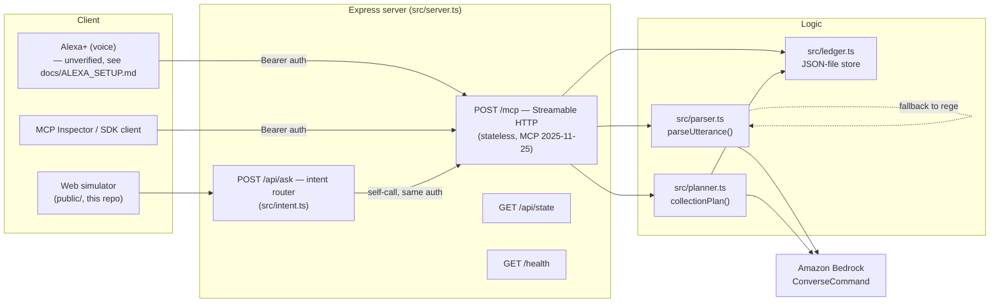

# Udhaar

A voice-first credit ledger (udhaar/khata) for small shopkeepers, built as a
self-hosted **Alexa+ MCP server** over Streamable HTTP, backed by **Amazon
Bedrock** for understanding mixed-language speech and drafting collection
messages.

Built for Amazon's Build, Ship, Shape hackathon — Alexa+ track, plus the AWS
Builder and Open Source mini-challenges.

## The problem

Millions of small Indian shops run on a paper notebook (*khata*) of who owes
what. It's error-prone, hard to search, impossible to back up, and useless
hands-free when a shopkeeper is mid-sale with both hands full of goods. A
voice assistant that can record "Ramu took two hundred rupees of rice on
credit" while the shopkeeper keeps working — and later tell them who to
follow up with — replaces that notebook without asking anyone to learn an
app.

## The demo in 30 seconds

Open the web simulator (`GET /`, see [Setup](#setup-and-run)) and speak or
type:

1. *"Ramu took two hundred rupees of rice on credit and Kumar paid five
   hundred"* → both entries recorded in one sentence, parsed by Bedrock
   (or a regex fallback if Bedrock isn't configured).
2. *"How much does Ramu owe?"* → spoken balance.
3. *"Who should I follow up with today?"* → ranked list with a drafted,
   polite reminder message per customer.
4. The ledger panel on the right updates live after every action.

## Why this isn't a thin wrapper

- **Bedrock-backed understanding with a graceful fallback.** Spoken,
  code-mixed sentences (English + transliterated Tamil/Hindi — *udhaar*,
  *baaki*, *kadan*) are parsed by a Bedrock `ConverseCommand` call
  (`src/parser.ts`). If Bedrock is unavailable, misconfigured, or disabled
  (`UDHAAR_DISABLE_BEDROCK=1`), a regex-based rules engine takes over
  automatically — the tool never crashes or goes silent, it just reports
  which engine it used (`structuredContent.engine`).
- **Proactive collection planning, not just a balance lookup.**
  `collection_plan` ranks customers by `balance × recency` and drafts a
  warm, non-threatening reminder per customer — in the shopkeeper's
  requested language — via Bedrock, again falling back to a plain template
  if Bedrock is unavailable.
- **Multilingual by design**, not just English with a translation layer
  bolted on: the Bedrock prompts are written to understand code-mixed
  Tamil/Hindi/English input directly, and `collection_plan` can draft
  output in a requested language.
- **Voice-shaped responses.** Every tool returns one or two short spoken
  sentences (plus `structuredContent` for UIs) — not JSON dumps, not
  markdown tables, because the Alexa+ assistant on the other end has to
  read it aloud.
- **A real, spec-compliant MCP server**, not a demo stub: stateless
  Streamable HTTP per MCP 2025-11-25, validated against the official
  `@modelcontextprotocol/inspector` CLI and the official SDK client
  end-to-end (`src/smoke-test.ts`), with bearer-token auth and a
  Docker/App Runner deployment path.

## Architecture



## Tools

| Tool | Use when the shopkeeper says... | Notes |
|---|---|---|
| `record_credit` | "Ramu took 200 rupees of rice on credit" | Direct, structured input |
| `record_payment` | "Kumar paid 500" | Reports "fully settled" at balance ≤ 0 |
| `record_from_speech` | Any free-form sentence, possibly multiple entries, possibly code-mixed | Bedrock or rules fallback |
| `get_balance` | "How much does Ramu owe?" | Includes last 3 movements |
| `list_dues` | "Who owes me money?" | Biggest balance first, optional overdue filter |
| `daily_summary` | "How was today?" | Credit, payments, entry count, total outstanding |
| `payment_reminder` | "Remind Ramu to pay" | Optional UPI deep link (`upi://pay?...`) |
| `collection_plan` | "Who should I follow up with today?" | Ranked by `balance × recency`, Bedrock-drafted or templated messages |

## Setup and run

```bash
npm install
cp .env.example .env    # fill in what you need; see below
npm run dev              # tsx src/server.ts, serves on :3000
```

Open `http://localhost:3000/` for the web simulator, or point an MCP client
at `http://localhost:3000/mcp`.

Everything works with **no AWS credentials at all** if you set
`UDHAAR_DISABLE_BEDROCK=1` — speech parsing and reminder drafting fall back
to deterministic regex/template logic, useful for offline development or a
no-AWS demo.

### Bedrock setup

1. In the [Bedrock console](https://console.aws.amazon.com/bedrock/) for
   your target region, go to **Model access** and request access to an
   Anthropic Claude model (usually instant approval).
2. Find a valid, invokable model ID for your region/credentials:
   ```bash
   aws bedrock list-inference-profiles --region <your-region> \
     --query "inferenceProfileSummaries[].inferenceProfileId"
   ```
   Many current Claude models require an **inference profile ID**
   (`us.anthropic.claude-...`, `eu.anthropic.claude-...`,
   `global.anthropic.claude-...`), not the raw foundation-model ID.
3. Set in `.env`:
   ```
   AWS_REGION=<your-region>
   BEDROCK_MODEL_ID=<the inference profile ID from step 2>
   ```
4. Standard AWS credential chain only (`aws configure`, `AWS_PROFILE`,
   instance/task role) — no credentials are ever hardcoded.

### Environment variables

See `.env.example` for the full, documented list (`PORT`, `AWS_REGION`,
`BEDROCK_MODEL_ID`, `UDHAAR_API_KEY`, `UDHAAR_DISABLE_BEDROCK`,
`UDHAAR_DATA_FILE`).

## Tests

```bash
npx tsc --noEmit    # type check
npm run test:unit   # node:test unit tests — ledger, parser, planner, intent router
npm test             # end-to-end: spins up a real server, drives it with the
                      # official MCP SDK client over Streamable HTTP, asserts
                      # on actual tool results (not just "it responded")
```

## Deploy

Docker + AWS App Runner, with an IAM instance role scoped to exactly
`bedrock:InvokeModel`, a health-check wired to `/health`, and a cost/shutdown
note: see [`deploy/README.md`](deploy/README.md). The Docker image has been
built and smoke-tested locally (non-root user, `/health` and `/mcp` both
verified inside the container); the App Runner deployment steps themselves
require an AWS account and have not been executed by anyone but you.

## Security notes

- No hardcoded credentials anywhere; AWS access only via the standard SDK
  credential chain.
- `/mcp` and `/api/*` require `Authorization: Bearer <UDHAAR_API_KEY>` when
  that variable is set (constant-time comparison); unset means auth is open
  — set it before exposing the server publicly. `/health` always stays open
  for load balancer health checks.
- The bearer-token scheme here is **not** full OAuth 2.1 — Alexa+'s
  documented requirement for real device registration is OAuth 2.1 with
  PKCE, which this repo does not implement (see
  [`docs/ALEXA_SETUP.md`](docs/ALEXA_SETUP.md) for the honest gap analysis).
- The JSON-file ledger store is demo-grade (not concurrent-write-safe,
  not durable across container restarts on App Runner) — see the DynamoDB
  note in `deploy/README.md` for the production path.

## What's verified vs simulated

- **Verified**: Streamable HTTP MCP server behavior (Inspector CLI + the
  official SDK client, both over real HTTP), bearer auth (401/200 paths),
  Bedrock parsing/drafting with regex/template fallback, the Docker image
  running as non-root locally.
- **Simulated**: the "Alexa+" experience is demonstrated via the included
  web simulator (`public/`), which speaks to the same `/mcp` tools over the
  same Streamable HTTP protocol an Alexa+ registration would use — browser
  speech recognition/synthesis stand in for the device. Real Alexa+ device
  registration has not been completed; see `docs/ALEXA_SETUP.md` for exactly
  what that would take and why it's marked unverified.

## Hackathon mapping

- **Alexa+ track (primary)**: self-hosted MCP server, Streamable HTTP, MCP
  spec 2025-11-25, voice-shaped tool responses.
- **AWS Builder mini-challenge**: Amazon Bedrock (`ConverseCommand`) for
  speech parsing and message drafting; AWS App Runner + ECR deployment path.
- **Open Source mini-challenge**: see the project's hackathon submission
  notes for the external contribution made during the hackathon window
  (tracked separately from this repo's own commits).

## License

MIT — see [`LICENSE`](LICENSE).
